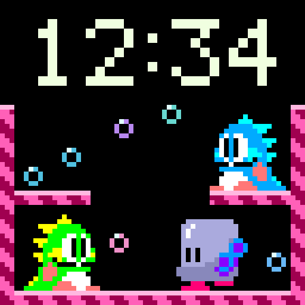

# Pack 2 — 2.2.0

Adds **Bubble Bobble - Bubble Trouble**, bringing Pack 2 to 15 scenes and the full
catalog to 45. Bub traps Zen-Chan, jumps to pop the bubble, and collects the fruit
while Bob watches. Six spaced background bubbles brighten the stage. The action
plays once per minute, then returns to idle.

Requires **sntl-2.2.0 or later**. After this collection reaches the catalog's main
branch, press **Refresh Scene Library** in Home Assistant, choose **Pack 2**, then
select the scene. No firmware rebuild or flash is required.

[Download all 15 scenes](native-clock-pack-2-2.2.0.zip) · [Manifest](pack-2/manifest.json) · [Artwork credits](CREDITS.md) · [Validation](validation.json)

Extract the complete ZIP and open `previews/index.html` to play all 15 scenes
offline. The preview handles hour and midnight rollover. Use **Next minute** to
trigger the action. GIFs repeat the action for demonstration; the clock waits for
a real minute change. Manifest paths resolve relative to `pack-2/manifest.json`;
`catalog_path` identifies each online asset.

All previous 14 scenes retain their exact native bytes and catalog paths. Only the
new Bubble Bobble entry points into this collection. The original 44 catalog
entries and previous archives remain unchanged.

Bubble Bobble's 128 source frames and clock overlays match the production decoder.
Both GIF sizes preserve the exact rendered pixels. ASan/UBSan, 2,000 incremental
redraw comparisons, minute/midnight timing, malformed inputs, actor collisions,
and pop-at-contact checks pass. Hardware playback of Bubble Bobble is untested.
The existing three NES scenes' historical host reports are retained in
`validation.json`; they are separate from the new scene's checks.

The source sheets are in `sources/bubble-bobble/`; the workspace renderer and
validator are in `build-source/bubble-bobble/`. Like the retained NES builders,
these scripts record the authoring source and require the existing SNES-clock
workspace encoder/test harness. They are not standalone build tools. `overview.png`
is the historical three-scene NES overview; the new animation is shown below.

